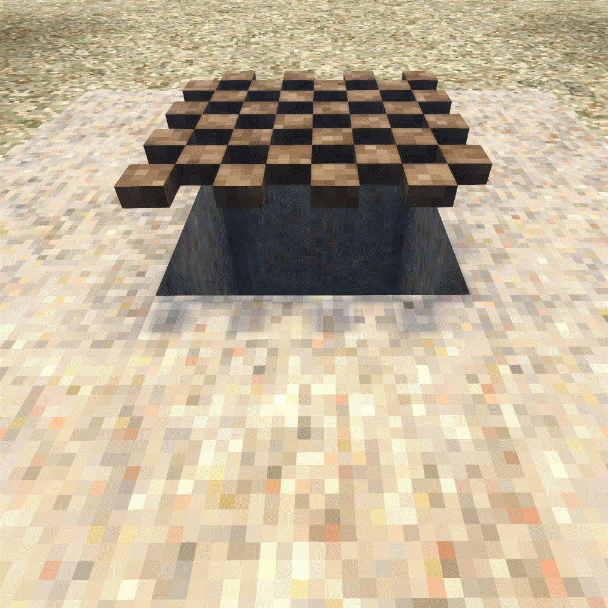

# QP's Chisel Tools Shadow Fix

Client- and Server-side fix for the pantograph/multigraph Shadow bug in QP's Chisel Tools.

Have you ever noticed weird lighting/shadow bugs when pasting with your pantograph? Have you been tired of having to "flip" blocks with the chisel to get it to "update the light of the block"? Even though it kinda looks like QP does update the block's shadow and lighting, especially after 1.7.3?
Well, it is called Absorption by Vintage Story, and QP's Chisel Tools doesn't ask the game to update it. However, with this mod it does!

This mod is a tiny Server only mod. It was initially designed as a fix for both sides but the client-only version only fixed the bug for *you* on blocks *you* edit. This would make the light around chiselled blocks look different for different clients on the same server if the server did not have the mod (even for two players both with the fix installed). The only way to fix this is a server side part of the mod, in which case the design is just cleaner as a server-only mod.

The fix also works in single player (since a single player game just runs a server locally)

## The bug explained
QP's Chisel Tools isn't Open Source (as far is I can see?) so some of the following assumptions can be wrong!

The fundemental issue is that QP's Chisel Tools edits voxels directly in a block without asking the game to update the cuboid list. This means that the game never gets a chance to recalculate a new Absorption value, which means adjecent blocks never gets their light "recalculated". QP's Chisel Tools did try and fix this in version 1.17.3 but since it still doesn't recalculate the cuboid list it still operates on a stale absorption value. Also, as far as I can see it only tries to "relight" on PasteMaterials which is not the only mode where the shape (and therefore absorption) of a block is changed.

See [ChiselToolsShadowFixSystem.cs](https://github.com/hutli/chiseltools-shadow-fix/blob/main/src/ChiselToolsShadowFixSystem.cs) -> `FixAbsorption` function to see how I force absorption recalculation.
